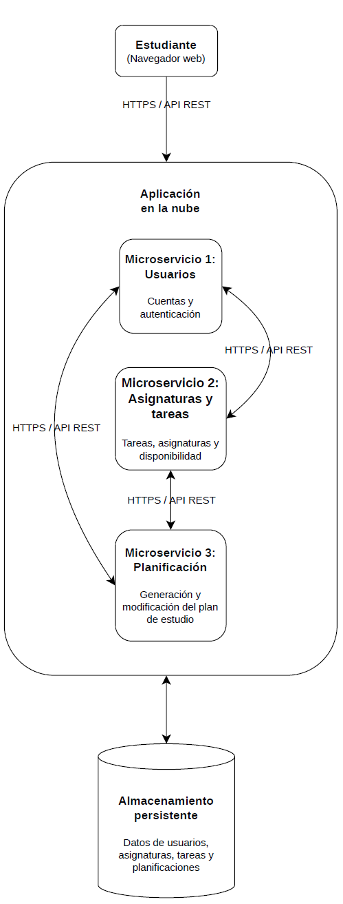

# **Planificador de estudio en la nube**

## **1. Descripción del dominio**

La idea de este proyecto es crear una aplicación web que ayude a los estudiantes a organizar mejor su tiempo de estudio. Muchas veces, al tener varias asignaturas y trabajos pendientes, resulta complicado decidir por qué tarea empezar y cuánto tiempo dedicar a cada una. Por eso, la aplicación permitirá organizar las asignaturas y sus tareas teniendo en cuenta aspectos como la fecha de entrega, la dificultad, la importancia y el tiempo que se calcula que llevará realizarlas.

Cada estudiante tendrá su propio espacio dentro de la aplicación, donde podrá añadir sus asignaturas y tareas e indicar las horas que tiene disponibles para estudiar cada día. A partir de esa información, la aplicación generará una propuesta de planificación que podrá modificar si necesita adaptarla a sus circunstancias. También podrá marcar las tareas que haya terminado y consultar su progreso. Además, cada estudiante tendrá sus propios datos, de manera que su información no se mezcle con la de otros usuarios.

## **2. Casos de uso**

Los principales casos de uso de la aplicación son:

- **Gestión de asignaturas y tareas:** el estudiante podrá añadir sus asignaturas y registrar las tareas que tiene pendientes, indicando su fecha de entrega, importancia, dificultad y duración aproximada.
- **Configuración del tiempo disponible:** podrá indicar cuántas horas tiene para estudiar cada día.
- **Generación del plan de estudio:** la aplicación propondrá una distribución de las tareas teniendo en cuenta el tiempo disponible del estudiante, las fechas límite, la importancia, la dificultad y la duración estimada de cada tarea.
- **Modificación del plan:** el estudiante podrá realizar cambios en la planificación para adaptarla a sus necesidades.
- **Seguimiento del trabajo:** podrá marcar las tareas como completadas y consultar cuáles siguen pendientes.
- **Gestión de la información personal:** cada estudiante podrá consultar y modificar sus propios datos sin acceder a la información de otros usuarios.

## **3. Relación con las características esenciales del Cloud Computing (NIST SP 800-145)**

El planificador de estudio se plantea como una aplicación web alojada en la nube, lo que permitiría que los estudiantes utilizaran sus funcionalidades sin tener que instalar la aplicación en sus propios equipos. A continuación, se explica cómo se relaciona el proyecto con las cinco características esenciales del Cloud Computing definidas en NIST SP 800-145.

### **3.1. Autoservicio bajo demanda**

El planificador dispondrá de los recursos informáticos necesarios para funcionar y permitir que los estudiantes utilicen sus funcionalidades cuando las necesiten. Además, la infraestructura se configurará para que los recursos necesarios puedan asignarse automáticamente según las necesidades del servicio, sin que sea necesaria la intervención manual del proveedor en cada solicitud.

### **3.2. Acceso amplio a la red**

Al tratarse de una aplicación web, el planificador podrá utilizarse a través de la red desde distintos dispositivos, como ordenadores, portátiles, tabletas o móviles, siempre que dispongan de conexión a Internet. Así, el estudiante podrá consultar sus tareas, revisar su planificación o actualizar su progreso desde diferentes dispositivos, sin tener que utilizar necesariamente el mismo equipo. Este acceso deberá combinarse con medidas que protejan la información personal de cada usuario.

### **3.3. Agrupación o asignación común de recursos**

La infraestructura en la nube podrá compartir recursos físicos y virtuales entre los distintos usuarios de la aplicación. Por ejemplo, no sería necesario dedicar un servidor físico diferente a cada estudiante, sino que varios usuarios podrían utilizar los recursos de una misma infraestructura. La capacidad disponible se podría asignar y redistribuir según las necesidades del servicio; pero aunque los recursos sean compartidos, la aplicación deberá mantener separados los datos de cada estudiante, de modo que cada usuario solo pueda consultar y gestionar su propia información.

### **3.4. Rápida elasticidad**

El número de estudiantes que utilicen el planificador podría variar a lo largo del tiempo, por ejemplo, durante los periodos de exámenes o de entrega de trabajos. Por ello, sería conveniente que la infraestructura pudiera aumentar automáticamente los recursos disponibles cuando crezca la demanda y reducirlos cuando disminuya. Esta capacidad permitiría adaptar el servicio al número de usuarios y evitar mantener permanentemente la misma cantidad de recursos, incluso cuando no fueran necesarios.

### **3.5. Servicio medido**

El consumo de los recursos utilizados por el planificador podrá medirse y controlarse para conocer el uso de la capacidad de procesamiento, el almacenamiento y otros recursos de la infraestructura. Esta información permitirá conocer los costes asociados al alojamiento de la aplicación y valorar si los recursos utilizados se ajustan a las necesidades del servicio. De esta manera, será posible llevar un seguimiento del consumo y tomar decisiones sobre el uso de la infraestructura.

## **4. Mapeo de actores según NIST SP 500-292**

En el planificador de estudio intervienen distintos actores relacionados con el uso y la gestión de los servicios en la nube. Cada uno tiene una función y puede influir de una forma u otra en los costes del proyecto.

### **4.1. Consumidor de la nube**

Será el estudiante que utilice la aplicación para organizar sus tareas y consultar su planificación. Podrá acceder desde distintos dispositivos sin necesitar una infraestructura propia, lo que facilita su uso y evita gastos individuales en servidores.

### **4.2. Proveedor de la nube**

Será la empresa que proporcione los recursos necesarios para alojar la aplicación y almacenar los datos. Esto evita comprar servidores propios, aunque será necesario controlar el consumo para no generar costes innecesarios.

### **4.3. Intermediario de la nube**

Facilita la gestión o combinación de servicios de distintos proveedores. En principio, el proyecto podría prescindir de él si utiliza un único proveedor, simplificando la solución y evitando posibles gastos adicionales.

### **4.4. Auditor de la nube**

Revisa aspectos como la seguridad y el cumplimiento de los requisitos. Su función permitiría comprobar que los datos de los estudiantes están protegidos. Aunque una auditoría puede tener un coste, también ayuda a detectar problemas y prevenir gastos futuros.

### **4.5. Operador de la nube**

Es quien proporciona la conectividad entre el proveedor de la nube y el consumidor. En este proyecto, esta función la desempeñaría el operador de telecomunicaciones cuya red permite a los estudiantes acceder a la aplicación a través de Internet.

### **4.6. Impacto económico**

La nube permite comenzar con una inversión inicial reducida, sin comprar servidores propios. No obstante, será importante controlar los gastos de alojamiento y almacenamiento, utilizando los recursos necesarios para mantener un servicio adecuado y poder ampliarlo si aumenta el número de usuarios.

## **5. Diagrama de arquitectura**



## **6. Especificación de la API REST**

La aplicación contará con tres microservicios que se repartirán las distintas funcionalidades del planificador. La comunicación entre ellos se realizará mediante HTTP/REST y se utilizará JSON para intercambiar información. El acceso desde el navegador se hará mediante HTTPS y las operaciones que lo requieran estarán protegidas mediante autenticación.

### **6.1. Microservicio de usuarios**

Este microservicio se encargará de gestionar las cuentas de los estudiantes y permitirles acceder a la aplicación.

| Método HTTP | Ruta | Descripción |
|---|---|---|
| `POST` | `/usuarios/registro` | Crear una cuenta de usuario. |
| `POST` | `/usuarios/login` | Iniciar sesión y obtener un token de autenticación. |
| `GET` | `/usuarios/perfil` | Consultar los datos de la cuenta del usuario autenticado. |

### **6.2. Microservicio de asignaturas y tareas**

Permitirá gestionar las asignaturas y las tareas de cada estudiante, registrar su estado y configurar el tiempo disponible para estudiar.

| Método HTTP | Ruta | Descripción |
|---|---|---|
| `GET` | `/asignaturas` | Consultar las asignaturas del estudiante. |
| `POST` | `/asignaturas` | Añadir una nueva asignatura. |
| `GET` | `/tareas` | Consultar las tareas registradas. |
| `POST` | `/tareas` | Crear una tarea asociada a una asignatura. |
| `PUT` | `/tareas/{id}` | Modificar los datos de una tarea. |
| `PATCH` | `/tareas/{id}/completada` | Marcar una tarea como completada. |
| `PUT` | `/disponibilidad` | Establecer las horas disponibles para estudiar. |

### **6.3. Microservicio de planificación**

Este microservicio se ocupará de generar una propuesta de estudio a partir de las tareas pendientes y del tiempo disponible del estudiante. También permitirá consultar y modificar los planes generados.

| Método HTTP | Ruta | Descripción |
|---|---|---|
| `POST` | `/planificaciones` | Generar una nueva planificación de estudio. |
| `GET` | `/planificaciones/actual` | Consultar la planificación actual del estudiante. |
| `PUT` | `/planificaciones/{id}` | Modificar una planificación existente. |

### **6.4. Ejemplos de intercambio de información**

Para registrar una tarea, se enviará una petición `POST /tareas` con los datos necesarios en formato JSON. Por ejemplo:

**Petición:**

```json
{
  "asignatura_id": 1,
  "titulo": "Práctica de Cloud Computing",
  "fecha_entrega": "2026-11-15",
  "importancia": "alta",
  "dificultad": 3,
  "duracion_estimada": 120
}
```

**Respuesta de ejemplo:**

```json
{
  "id": 25,
  "asignatura_id": 1,
  "titulo": "Práctica de Cloud Computing",
  "estado": "pendiente"
}
```

Al iniciar sesión, el microservicio de usuarios devolverá un token de acceso que permitirá a los demás microservicios identificar al estudiante y garantizar que cada usuario solo pueda acceder a sus propias tareas y planificaciones.
